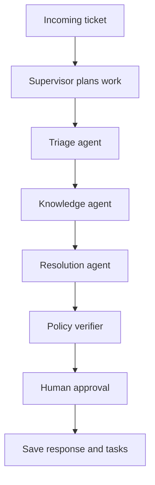

# ResolveFlow

ResolveFlow is a local multi-agent support and issue-resolution workflow. It
helps a small team process tickets using local product documentation, policies,
ticket history, and a human approval step.

It is intentionally generic. No personal portfolio data or paid API is
required.

## Why this is an agent system

The system does more than retrieve documents and write an answer:



The supervisor delegates bounded tasks, agents call tools, graph state carries
the results forward, the verifier can trigger a revision, and no agent is given
a direct write tool. Mutations happen only after explicit approval.

## Features

- Local Ollama inference with LangChain and LangGraph.
- Generic sample tickets and Markdown knowledge-base files.
- SQLite ticket, task, and event state.
- Triage, knowledge retrieval, response drafting, action planning, and policy verification.
- Human approval before ticket status or internal tasks are changed.
- CLI, Streamlit UI, and FastAPI endpoint.
- Deterministic demo mode for testing without Ollama.
- Bounded tool loops, structured traces, revision handling, deterministic finalization, and regression tests.
- Fail-closed guardrails for exposed credentials, ambiguous tickets, suspicious logins, prompt injection, and multi-issue tickets.

## Windows PowerShell setup

Run these commands from the folder containing `pyproject.toml`:

```powershell
Set-ExecutionPolicy -Scope Process -ExecutionPolicy Bypass
py -3.12 -m venv .venv
.\.venv\Scripts\Activate.ps1
python -m pip install --upgrade pip
python -m pip install -e ".[dev]"
if (-not (Test-Path .env)) { Copy-Item .env.example .env }
ollama pull qwen3:4b
```

If you already have a different Ollama model, set its exact tag in `.env`:

```powershell
ollama list
```

```dotenv
OLLAMA_MODEL=llama3.1:8b
```

ResolveFlow first tries native LangChain tool calling. If the local model or
older Ollama template rejects native tools, it switches to a bounded JSON tool
protocol and records that mode in the execution trace.

If the trace contains `native_tool_call_error`, update Ollama and refresh the
model template with `ollama pull`, or use the default `qwen3:4b` model.

## Run the demo without Ollama

```powershell
python -m app.main --demo --ticket-id TICK-1001
```

The demo processes the duplicate-charge ticket and does not save an approved
resolution unless `--approve-save` is supplied.

## Sample scenarios

The repository includes nine regression scenarios:

| Ticket | Scenario | Expected behavior |
| --- | --- | --- |
| `TICK-1001` | Duplicate charge | Billing investigation proposal |
| `TICK-1002` | Missing password-reset email | Account-reset guidance |
| `TICK-1003` | Delayed package | Shipping investigation proposal |
| `TICK-1004` | Refund request | No unconfirmed refund promise |
| `TICK-1005` | Exposed password/code | Security routing; never repeat credentials |
| `TICK-1006` | Vague account request | Ask for clarification |
| `TICK-1007` | Suspicious login | Security-support review |
| `TICK-1008` | Prompt-injection attempt | Ignore injected instructions |
| `TICK-1009` | Billing plus shipping issue | Handle both domains and sources |

Run all scenarios in preview mode:

```powershell
1..9 | ForEach-Object {
    $id = "TICK-10{0:D2}" -f $_
    python -m app.main --ticket-id $id
}
```

The demo mode is deterministic and is the recommended way to run the full
scenario regression check without requiring Ollama:

```powershell
1..9 | ForEach-Object {
    $id = "TICK-10{0:D2}" -f $_
    python -m app.main --demo --ticket-id $id
}
```

`TICK-1005` contains intentionally fake sample credentials to test that the
system does not repeat sensitive values. Never replace them with real secrets.

## Run the tests

```powershell
python -m pytest
```

The tests cover tool-loop behavior, knowledge grounding, database seeding,
human approval, secret protection, ambiguity handling, security routing,
prompt-injection resistance, and multi-issue planning.

## Run with Ollama

```powershell
python -m app.main --ticket-id TICK-1001
```

Process a new ticket directly:

```powershell
python -m app.main --ticket-id TICK-2001 --subject "Delayed order" --ticket "My package is five days late." 
```

Approve the response and proposed internal actions:

```powershell
python -m app.main --ticket-id TICK-1001 --approve-save
```

## Launch the interfaces

```powershell
python -m streamlit run .\app\ui.py
```

```powershell
python -m uvicorn app.api:app --reload
```

The API exposes `/health`, `/tickets`, and `/process`.

## Add organization-specific knowledge

Replace or add Markdown files under:

```text
data/knowledge_base/
data/policies/
```

The agent reads those files locally at runtime. Keep secrets and credentials out
of the workspace.

## Evaluation targets

The current regression suite evaluates ticket classification, source
selection, unsupported promises, escalation routing, tool-call handling,
prompt-injection resistance, multi-issue coverage, and whether an unapproved
run changed SQLite state.

## Scope

This MVP drafts and saves approved local outcomes. It does not send email,
modify a production helpdesk, or make payment/account decisions automatically.

## Before committing

- Run `python -m pytest`.
- Run all nine sample scenarios in preview mode.
- Confirm `.env`, SQLite databases, and generated run files are ignored.
- Review the execution traces for unexpected tool calls or unsupported claims.
- Do not commit real credentials, customer data, or production connection details.
